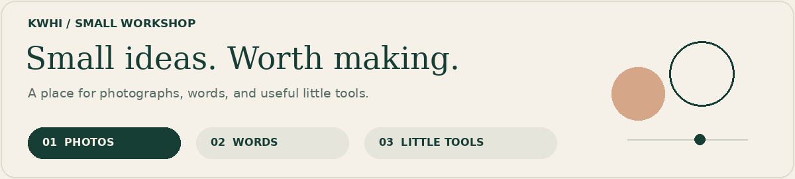
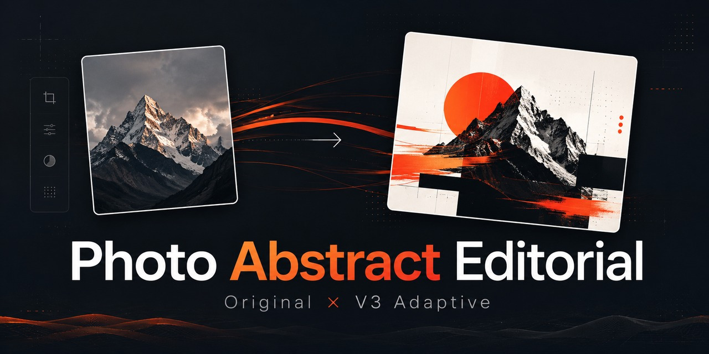
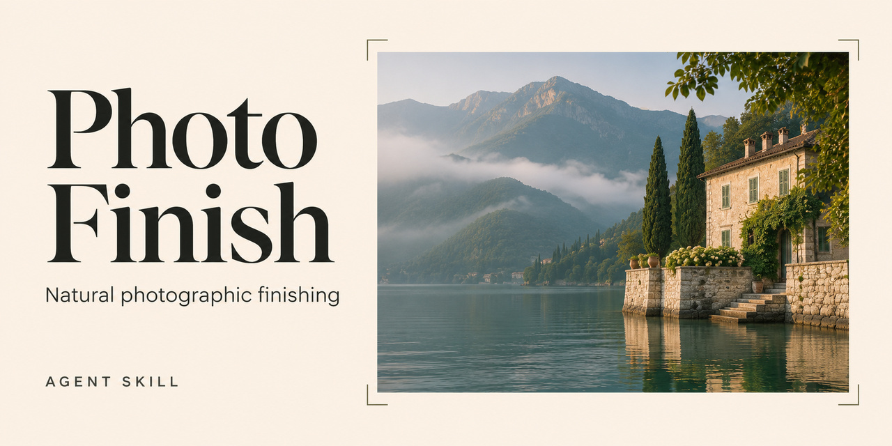
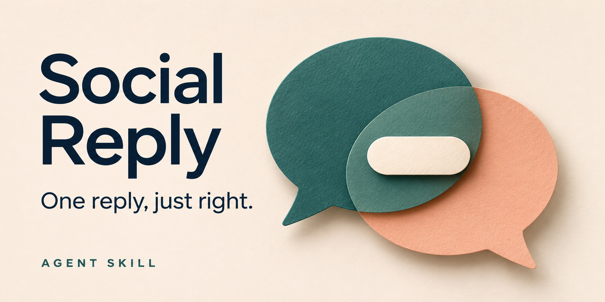
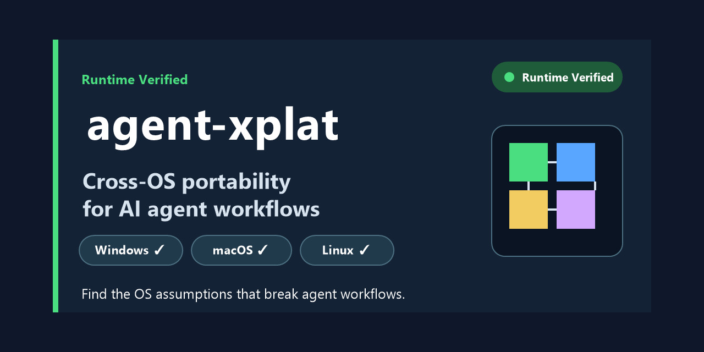
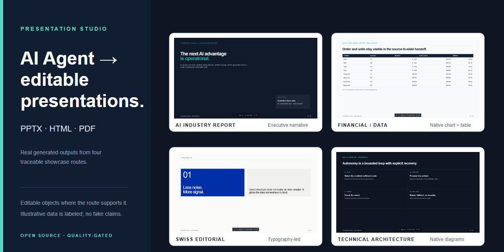

<picture>
  <source media="(prefers-reduced-motion: reduce)" srcset="https://raw.githubusercontent.com/kwhi6693-web/kwhi6693-web/main/assets/workshop-static.png">
  
</picture>

# kwhi

**Curious about AI. Particular about the details.**

[English](README.md) · [简体中文](README.zh-CN.md)

Hi, I'm kwhi. I like turning “could this be better?” into something you can actually try.

Sometimes that means finding the right light in a photograph. Sometimes it's finding the words for a reply, or making an agent workflow feel a little less fragile. Photography, visual design, and useful little tools are where my interests meet.

I enjoy the part where a promising first attempt becomes something worth keeping.

## 🧪 The workbench

### 01 · Light & images

- **[Photo Abstract Editorial](https://github.com/kwhi6693-web/photo-abstract-editorial)** — One photograph, another visual language: editorial layouts and controlled abstraction that respect the source. [Before / after](https://github.com/kwhi6693-web/photo-abstract-editorial#before-after) · [Validation](https://github.com/kwhi6693-web/photo-abstract-editorial#validation)
- **[Photo Finish](https://github.com/kwhi6693-web/photo-finish)** — A little more care for light, color, and composition. Natural finishing for non-portrait photos, with source comparison and versioned delivery. [Capabilities & limits](https://github.com/kwhi6693-web/photo-finish#capabilities-and-limits) · [Validation scope](https://github.com/kwhi6693-web/photo-finish/blob/main/docs/validation.md)
### 02 · Words & people

- **[Social Reply](https://github.com/kwhi6693-web/social-reply)** — For the moment when you know what you mean but can't quite find the words. One natural reply, with optional private memory and expression preferences. [How it works](https://github.com/kwhi6693-web/social-reply#-feature-map) · [Validation & compatibility](https://github.com/kwhi6693-web/social-reply#-validation-and-compatibility)

### 03 · Behind the scenes

**More tools:** [agent-xplat](https://github.com/kwhi6693-web/agent-xplat) finds portability assumptions in agent workflows ([example](https://github.com/kwhi6693-web/agent-xplat/tree/master/examples/mixed-workflow) · [CI](https://github.com/kwhi6693-web/agent-xplat/actions)); [Presentation Studio](https://github.com/kwhi6693-web/presentation-studio) produces editable presentation artifacts ([real showcases](https://github.com/kwhi6693-web/presentation-studio#showcase)).

🎞️ Open the project shelf · 5 covers

These images are project covers. The links above lead to actual examples and validation boundaries.

### Photo Abstract Editorial

### Photo Finish

### Social Reply

### agent-xplat

### Presentation Studio

## 🔎 Small things, big difference

- Light and color that give a photograph a mood without overwhelming it.
- Tools that save effort and leave you with something you can actually use.
- Words that sound like the person sending them.

**My favorite part:** the small adjustments that make the whole thing feel right. I build, inspect, and refine—and keep software checks separate from judging the finished result.

## 💬 The open door

A photo idea, a tool you wish existed, or a small annoyance worth fixing? [Say hello](https://github.com/kwhi6693-web/kwhi6693-web/issues/new). Half-formed ideas are welcome, too.

For a project question or bug, please use that project's issues so the conversation stays with the work.
