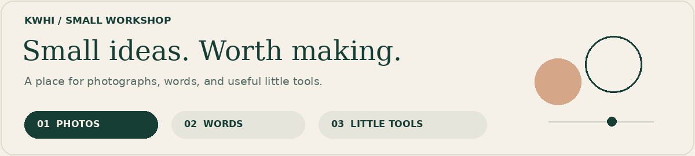
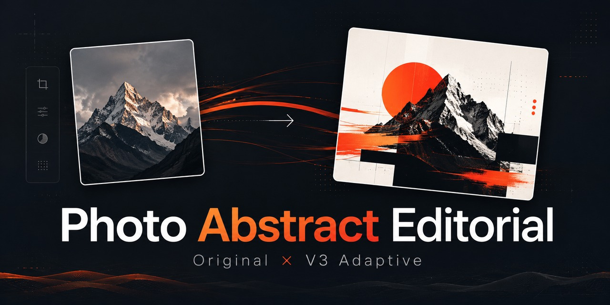
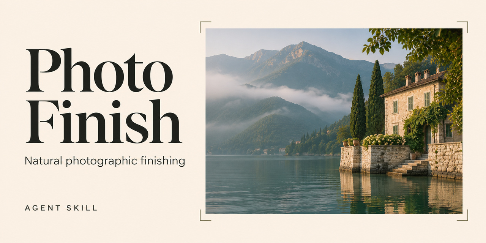
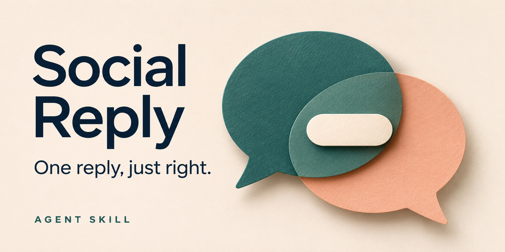
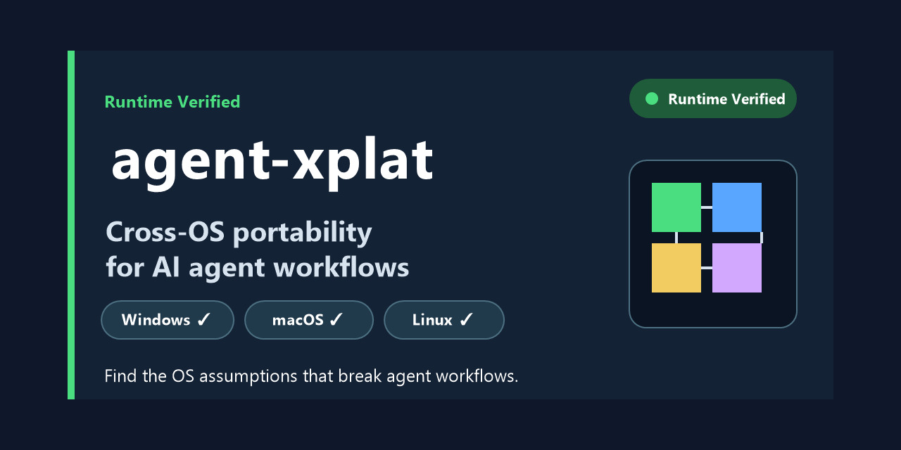
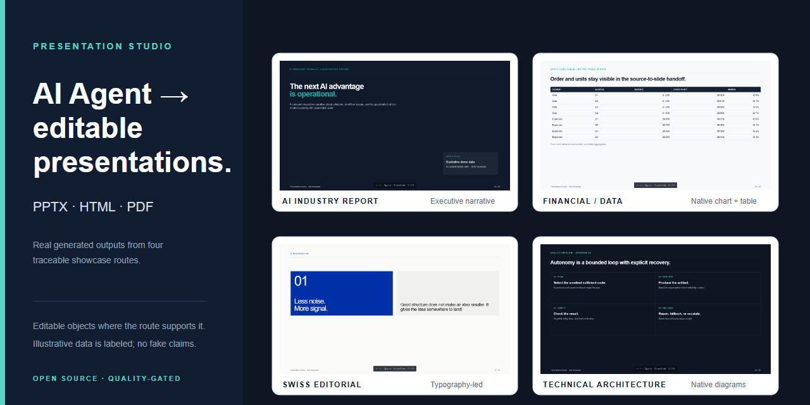

<picture>
  <source media="(prefers-reduced-motion: reduce)" srcset="https://raw.githubusercontent.com/kwhi6693-web/kwhi6693-web/main/assets/workshop-static.png">
  
</picture>

# kwhi

**对 AI 很好奇，对成品有点挑剔。**

[English](README.md) · [简体中文](README.zh-CN.md)

你好，我是 kwhi。我喜欢把一句「能不能再好一点？」变成可以亲手试试的东西。

可能是一张照片里的光线，一句怎么回都差点意思的话，也可能是一个总在关键时刻卡住的 Agent 工作流。摄影、视觉设计和实用的小工具，是我这些兴趣碰头的地方。

我很享受把一个有潜力的初稿，慢慢打磨到「这个值得留下」的过程。

## 🧪 把好奇心做成工具

### 01 · 光线与画面

- **[Photo Abstract Editorial](https://github.com/kwhi6693-web/photo-abstract-editorial)** — 让一张照片多一种表达：将摄影、可控抽象与编辑设计结合，同时尊重原始画面。[前后对照](https://github.com/kwhi6693-web/photo-abstract-editorial#before-after) · [验证说明](https://github.com/kwhi6693-web/photo-abstract-editorial#validation)
- **[Photo Finish](https://github.com/kwhi6693-web/photo-finish)** — 认真对待一张照片的光色与构图。面向非人像照片的自然后期，保留原片对照与版本记录。[能力与限制](https://github.com/kwhi6693-web/photo-finish#capabilities-and-limits) · [验证范围](https://github.com/kwhi6693-web/photo-finish/blob/main/docs/validation.md)
### 02 · 语言与表达

- **[Social Reply](https://github.com/kwhi6693-web/social-reply)** — 给「知道想说什么，却不知道怎么回」的时刻。一条自然的回复，可选私人记忆与表达偏好。[功能说明](https://github.com/kwhi6693-web/social-reply#-feature-map) · [验证与兼容性](https://github.com/kwhi6693-web/social-reply#-validation-and-compatibility)

### 03 · 幕后的小工具

**其他工具：**[agent-xplat](https://github.com/kwhi6693-web/agent-xplat) 检查 Agent 工作流中的跨平台假设（[示例](https://github.com/kwhi6693-web/agent-xplat/tree/master/examples/mixed-workflow) · [CI 记录](https://github.com/kwhi6693-web/agent-xplat/actions)）；[Presentation Studio](https://github.com/kwhi6693-web/presentation-studio) 生成可编辑的演示文稿与相关成果（[真实案例](https://github.com/kwhi6693-web/presentation-studio#showcase)）。

🎞️ 打开作品架 · 5 张项目封面

以下图片为项目封面；实际案例与验证边界请查看上方链接。

### Photo Abstract Editorial

### Photo Finish

### Social Reply

### agent-xplat

### Presentation Studio

## 🔎 我在意的那些小事

- 照片有氛围，光色也经得起细看。
- 工具替人省点力，最后真能留下可用的成果。
- 一句话发出去，依然像说话的人自己。

**最让我开心的部分：** 调整一个小细节，整个东西忽然就对了。我会反复查看、验证和打磨，也会区分软件检查与实际成品的好坏。

## 💬 来聊点有意思的

一个摄影点子、一款你希望有人做出来的工具，或生活里一个值得解决的小麻烦，都可以[来打个招呼](https://github.com/kwhi6693-web/kwhi6693-web/issues/new)。想法还没成形，也没关系。

具体项目的使用问题或缺陷，请在对应仓库提出，方便让讨论和作品放在一起。
