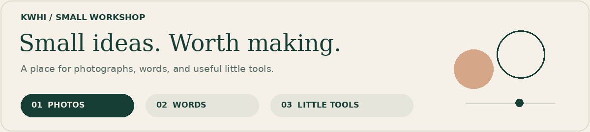
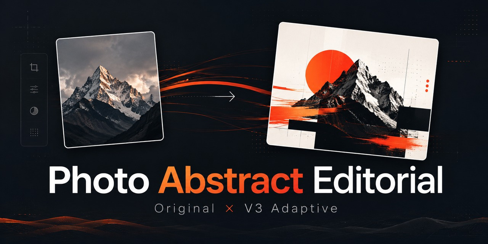
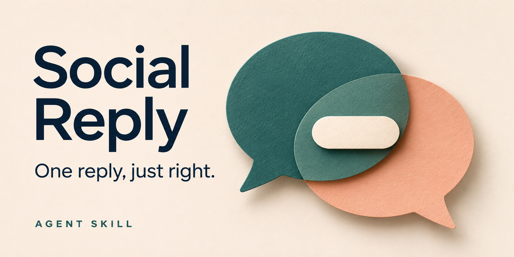
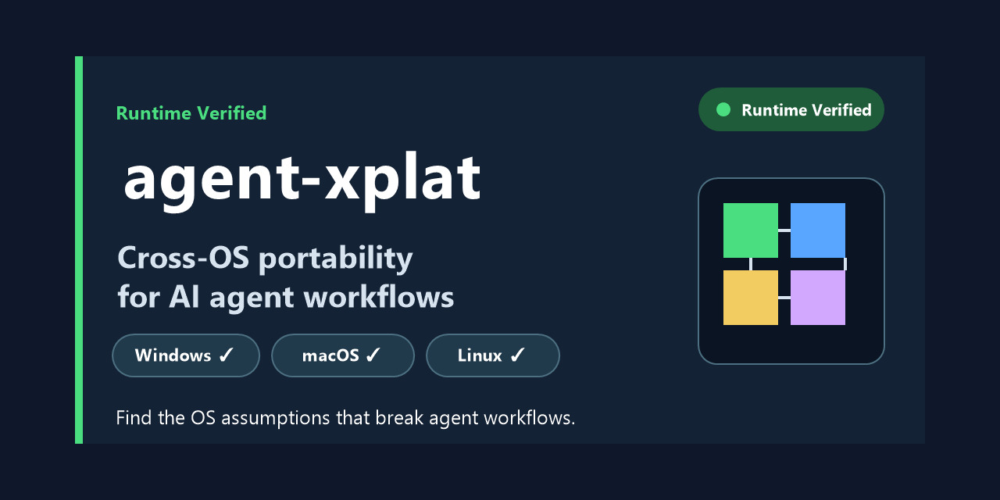
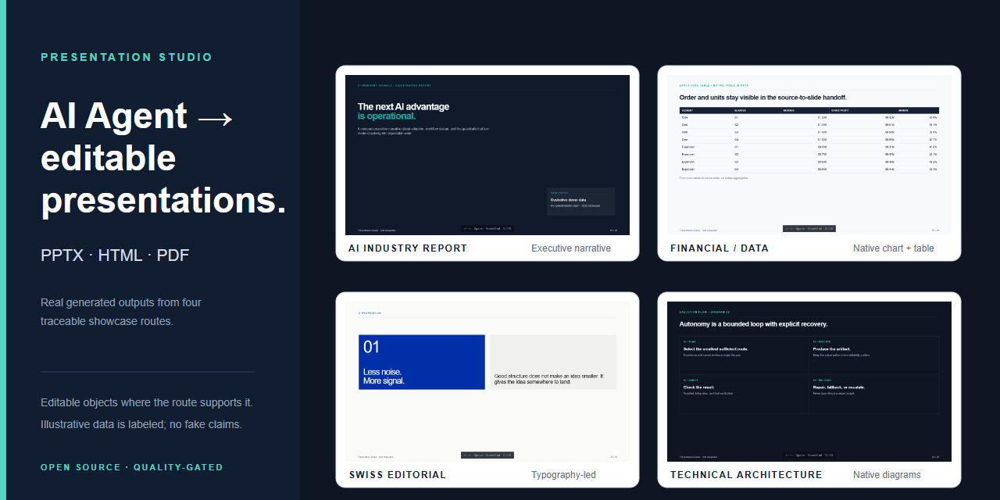

<picture>
  <source media="(prefers-reduced-motion: reduce)" srcset="https://raw.githubusercontent.com/kwhi6693-web/kwhi6693-web/main/assets/workshop-static.png">
  
</picture>

# kwhi

**對 AI 很好奇，對成品有點挑剔。**

[English](README.md) · [简体中文](README.zh-CN.md) · [繁體中文](README.zh-TW.md)

你好，我是 kwhi。我喜歡把一句「能不能再好一點？」變成可以親手試試的東西。

可能是一張照片裡的光線，一句怎麼回都差點意思的話，也可能是一個總在關鍵時刻卡住的 Agent 工作流程。攝影、視覺設計和實用的小工具，是我這些興趣交會的地方。

我很享受把一個有潛力的初稿，慢慢打磨到「這個值得留下」的過程。

## 🧪 把好奇心做成工具

### 01 · 光線與畫面

- **[Photo Abstract Editorial](https://github.com/kwhi6693-web/photo-abstract-editorial)** — 讓一張照片多一種表達：將攝影、可控抽象與編輯設計結合，同時尊重原始畫面。[前後對照](https://github.com/kwhi6693-web/photo-abstract-editorial#before-after) · [驗證說明](https://github.com/kwhi6693-web/photo-abstract-editorial#validation)
- **[Photo Finish](https://github.com/kwhi6693-web/photo-finish)** — 認真對待一張照片的光色與構圖。面向非人像照片的自然後製，保留原片對照與版本紀錄。[能力與限制](https://github.com/kwhi6693-web/photo-finish#capabilities-and-limits) · [驗證範圍](https://github.com/kwhi6693-web/photo-finish/blob/main/docs/validation.md)
### 02 · 語言與表達

- **[Social Reply](https://github.com/kwhi6693-web/social-reply)** — 給「知道想說什麼，卻不知道怎麼回」的時刻。一則自然的回覆，可選私人記憶與表達偏好。[功能說明](https://github.com/kwhi6693-web/social-reply#-feature-map) · [驗證與相容性](https://github.com/kwhi6693-web/social-reply#-validation-and-compatibility)

### 03 · 幕後的小工具

**其他工具：**[agent-xplat](https://github.com/kwhi6693-web/agent-xplat) 檢查 Agent 工作流程中的跨平台假設（[範例](https://github.com/kwhi6693-web/agent-xplat/tree/master/examples/mixed-workflow) · [CI 紀錄](https://github.com/kwhi6693-web/agent-xplat/actions)）；[Presentation Studio](https://github.com/kwhi6693-web/presentation-studio) 產生可編輯的簡報與相關成果（[實際案例](https://github.com/kwhi6693-web/presentation-studio#showcase)）。

🎞️ 打開作品架 · 5 張專案封面

以下圖片為專案封面；實際案例與驗證邊界請查看上方連結。

### Photo Abstract Editorial

### Photo Finish

### Social Reply

### agent-xplat

### Presentation Studio

## 🔎 我在意的那些小事

- 照片有氛圍，光色也經得起細看。
- 工具替人省點力，最後真能留下可用的成果。
- 一句話發出去，依然像說話的人自己。

**最讓我開心的部分：** 調整一個小細節，整個東西忽然就對了。我會反覆查看、驗證和打磨，也會區分軟體檢查與實際成品的好壞。

## 💬 來聊點有意思的

一個攝影點子、一款你希望有人做出來的工具，或生活裡一個值得解決的小麻煩，都可以[來打個招呼](https://github.com/kwhi6693-web/kwhi6693-web/issues/new)。想法還沒成形，也沒關係。

具體專案的使用問題或缺陷，請在對應的儲存庫提出，方便讓討論和作品放在一起。
